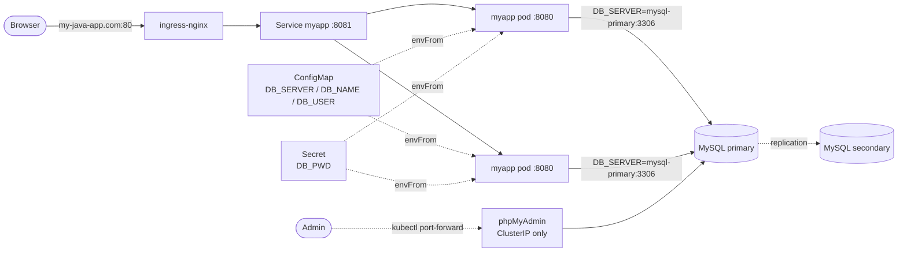

# Java + MySQL on Kubernetes with Helm & Helmfile

A Spring Boot web app backed by a replicated MySQL cluster, deployed to a self-hosted
kubeadm cluster (Proxmox homelab). The app went from Docker Compose to plain Kubernetes
manifests, then into a custom Helm chart. Helmfile deploys the whole stack with one command.

[](https://github.com/rikg215/k8s-java-mysql-helm/actions/workflows/ci.yaml)


## Architecture



| Component | How it's deployed | Notes |
|---|---|---|
| Java app (2 replicas) | Custom Helm chart `charts/myapp` | Image pulled from a **private** Docker Hub repo via `imagePullSecrets` |
| MySQL (primary + secondary) | Bitnami MySQL chart, `architecture: replication` | Persistent volumes per replica |
| Config | ConfigMap + Secret rendered by the chart | Injected with `envFrom`; pods roll automatically when either changes (checksum annotations) |
| Ingress | ingress-nginx, host `my-java-app.com` | Ingress → Service port 8081 → container port 8080 |
| phpMyAdmin | Plain manifest, ClusterIP | Deliberately not exposed; reached via `kubectl port-forward` |

## Tech

Kubernetes (kubeadm) · Helm · Helmfile · ingress-nginx · Docker · Spring Boot 3 / Java 17 · MySQL · GitHub Actions

## Repo layout

```
├── charts/
│   ├── myapp/            # custom chart: Deployment, Service, Ingress, ConfigMap, Secret
│   └── mysql/            # vendored Bitnami MySQL chart
├── values/
│   ├── myapp-values.yaml           # example per-environment overrides for developers
│   ├── myapp-secrets.yaml.gotmpl   # DB_PWD pulled from env at deploy time
│   ├── mysql-values.yaml
│   └── mysql-secrets.yaml.gotmpl
├── helmfile.yaml         # deploys mysql, then myapp
├── k8s/                  # the earlier plain-manifest version + phpMyAdmin
├── src/                  # Spring Boot app
├── Dockerfile            # multi-stage: Gradle build -> JRE runtime
└── .github/workflows/ci.yaml   # helm lint, kubeconform schema validation, image build
```

## Deploy

**Prerequisites:** a cluster with ingress-nginx installed, `helm`, `helmfile`.

```bash
# 1. Registry credentials for the private image (Docker Hub PAT with Read scope)
kubectl create namespace devops-bootcamp
kubectl create secret docker-registry docker-auth -n devops-bootcamp \
  --docker-username=<dockerhub-user> --docker-password='<PAT>'

# 2. Deploy MySQL + the app (passwords are read from the environment, never committed)
export DB_PASSWORD='<app-user-password>' DB_ROOT_PASSWORD='<root-password>'
helmfile sync

# 3. Point my-java-app.com at the ingress controller's IP (DNS record or /etc/hosts), then browse to it
kubectl get svc -n ingress-nginx
```

### phpMyAdmin (admin access only)

```bash
kubectl apply -f k8s/phpmyadmin.yaml
kubectl port-forward -n devops-bootcamp svc/phpmyadmin 8080:8080
# from a remote workstation: ssh -L 8080:localhost:8080 <user>@<control-host>
```

### Build the image

```bash
docker build -t <dockerhub-user>/<repo>:<tag> .
docker push <dockerhub-user>/<repo>:<tag>
```

## Problems I hit along the way

- **Build failed with `Could not find mysql:mysql-connector-j:9.2.0`.** Connector/J 9.x is only
  published under the `com.mysql` group ID. Fixed in `build.gradle`.
- **`ImagePullBackOff` with `insufficient_scope: authorization failed`.** The pull secret was correct
  and wired in properly, but the Docker Hub PAT's scope didn't allow pulling from a private repo.
  Regenerated the token with Read access.
- **The app needs exact env var names.** `DatabaseConfig.java` reads `DB_USER`, `DB_PWD`, `DB_SERVER`
  and `DB_NAME`, so the ConfigMap and Secret keys use those names and `envFrom` maps them
  without a per-variable `valueFrom` block.
- **Ingress backend port vs. container port.** The Ingress targets the **Service** port (8081),
  not the container port (8080). The Service's `targetPort` handles the hop to the pod.
- **The frontend hardcodes its API host.** `index.html` calls `http://my-java-app.com:80/...`, so
  the app only works when served through the Ingress on that hostname and port 80.

---
